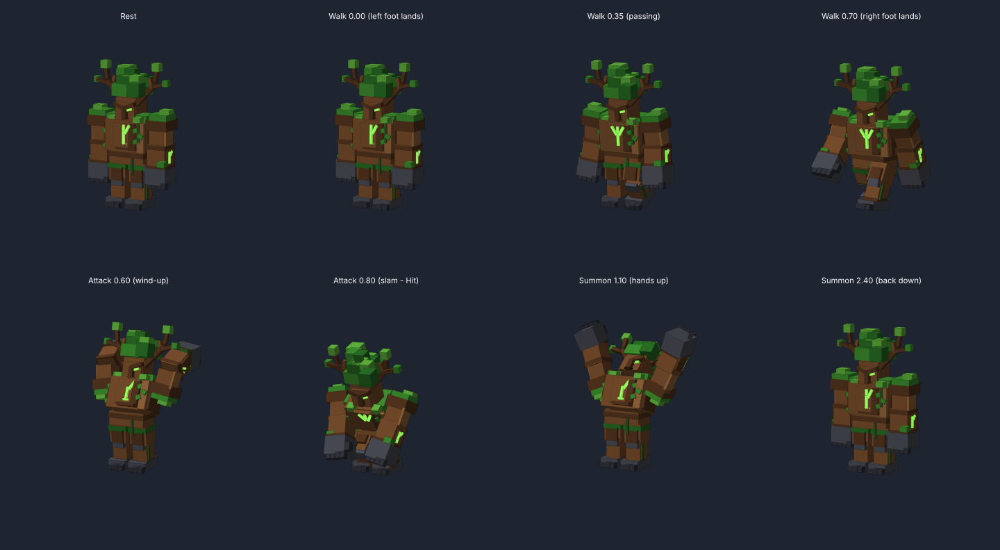

# Tree Guardian Boss

A blocky, rigged Tree Guardian boss for Roblox (about 15 studs tall), with three animations:

- **Walk**: a heavy, stomping walk that loops.
- **Attack**: raises both fists overhead and slams the ground. This sends out a shockwave that damages and knocks back nearby players.
- **Summon**: raises both hands to the sky, holds them there, then brings them back down. The runes flare and glowing roots burst out of the ground around it.



## Add it to your game

1. Open your place in Roblox Studio.
2. Open the Command Bar (**View > Command Bar**).
3. Open `TreeGuardian_CommandBar.lua`, copy the **whole file**, paste it into the Command Bar and press **Enter**.
4. A `TreeGuardian` model appears in front of your camera. It is already selected.
5. Press **Play**. The boss walks toward you, slams the ground when you get close, and summons every 14 seconds.

The model contains:

| Item | What it is |
| --- | --- |
| `HumanoidRootPart`, `LowerTorso`, `UpperTorso`, `Head`, arms, hands, legs, feet | The body parts, joined by Motor6Ds that use R15 names (`Root`, `Waist`, `Neck`, `LeftShoulder`, ...). The decorations are welded to them. |
| `Humanoid` | 2000 health, WalkSpeed 10, HipHeight 5. |
| `GuardianAnimations` (ModuleScript) | The keyframes for all three animations, and the code that plays them. |
| `GuardianBrain` (Script) | The boss AI and the effects for the attack and the summon. |

## Settings

Select the model and scroll to **Attributes** in the Properties window:

| Attribute | Default | Meaning |
| --- | --- | --- |
| `AggroRange` | 90 | How close (in studs) a player must be before the boss chases them. |
| `AttackRange` | 13 | How close a player must be before the boss slams. |
| `AttackDamage` | 30 | Damage the shockwave deals. |
| `AttackCooldown` | 3 | Seconds between slams. |
| `ShockwaveRadius` | 16 | Size of the shockwave. |
| `SummonCooldown` | 14 | Seconds between summons. |
| `WalkAnimationId`, `AttackAnimationId`, `SummonAnimationId` | empty | Optional. See the next section. |

To add your own effects, for example spawning minions on Summon, connect to the BindableEvents the brain creates:

```lua
model.Summoned.Event:Connect(function() --[[ spawn minions ]] end)
model.Attacked.Event:Connect(function(impactPosition) --[[ extra effects ]] end)
```

## Editing the animations in the Animation Editor

The animations work straight away, because they are played from code. The builder also saves them as real
KeyframeSequences, named `TreeGuardian_Walk`, `TreeGuardian_Attack` and `TreeGuardian_Summon`, under
`ServerStorage > RBX_ANIMSAVES > TreeGuardian`. You can tweak them and publish them:

1. **Avatar > Animation Editor**, then click the TreeGuardian model.
2. Click **⋯ > Load** and pick one of the `TreeGuardian_` animations.
3. Edit it if you want, then click **⋯ > Publish to Roblox** and copy the asset ID.
4. Paste the IDs into the model's `WalkAnimationId`, `AttackAnimationId` and `SummonAnimationId` attributes.

Once **all three** IDs are filled in, the boss plays them through the Humanoid's Animator instead of the code.
Keep the `Hit` marker on the slam and the `Summon` marker at the peak of the summon, because the effects fire on them.

## Changing the model's code

`TreeGuardian_CommandBar.lua` is generated. Edit the files in `src/` and then run:

```
python3 TreeGuardian/tools/bundle.py
```

- `src/BuildModel.lua`: builds the parts, joints, Humanoid and KeyframeSequences.
- `src/GuardianAnimations.lua`: the animation keyframes and the player.
- `src/GuardianBrain.server.lua`: the boss AI.
